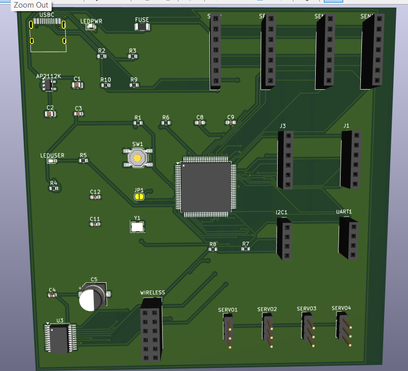
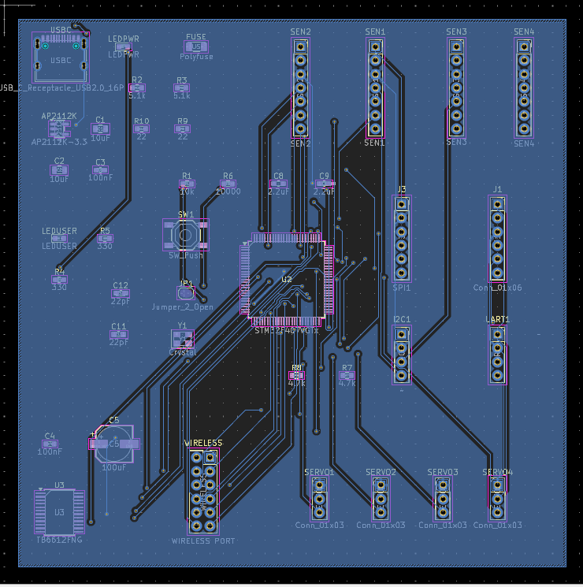
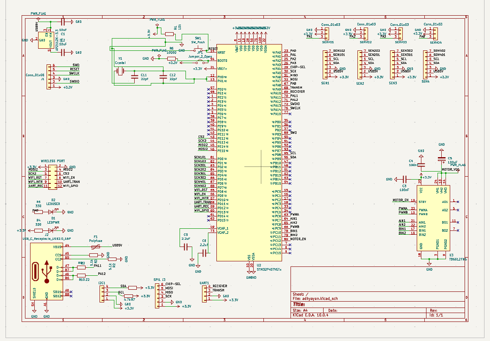
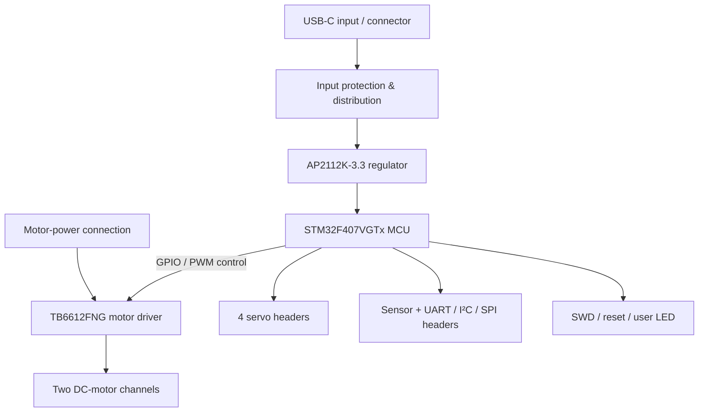

# Orion-1 | STM32F407 Robotics Controller PCB

**A custom, two-layer robotics controller designed from schematic to PCB layout in KiCad.**

Orion-1 is my first revision of a general-purpose embedded robotics control board. I designed it to bring the core building blocks of a small robot onto one PCB: an STM32 microcontroller, regulated logic power, a dual DC-motor driver, servo connections, debug access, and interfaces for sensors and peripherals.

> **Status — design-stage prototype (Rev 1).** KiCad design files and Gerber layers are included. The previous project notes report unresolved functional issues; I have **not** documented a successful powered-board bring-up or verified robot operation. The board should be reviewed and tested before relying on it in hardware.



<p align="center"><em>Orion-1: KiCad 3D board view</em></p>

## Project at a glance

| | |
| --- | --- |
| **MCU** | STM32F407VGTx (Arm Cortex-M4 family, LQFP-100) |
| **Motor driver** | TB6612FNG dual H-bridge |
| **Logic regulation** | AP2112K-3.3, 3.3 V LDO |
| **Power input/interface** | USB-C receptacle, polyfuse, separate motor-power net |
| **Expansion** | Four servo connectors, sensor headers, UART, I²C, SPI, wireless/auxiliary header |
| **Debug & controls** | SWD signals, reset circuit, oscillator footprint, user/power LEDs |
| **PCB** | 101.6 × 101.6 mm (4 × 4 in), two copper layers, 1.6 mm nominal thickness in the KiCad project |
| **EDA tools** | KiCad 10.0 (schematic, layout, 3D viewer and Gerbers) |

*The table describes elements found in the design files; it is not a claim that every interface has passed electrical or firmware testing.*

## Design views

| PCB routing / top view | Circuit schematic |
|:--:|:--:|
|  |  |

## Why I built it

I wanted to understand embedded hardware **beyond wiring modules together on a breadboard**. A robotics controller is a useful learning challenge because electrical decisions affect everything downstream: power distribution, motor noise, microcontroller stability, connector accessibility, and whether the finished board can actually be assembled and debugged.

Orion-1 took me through component selection, datasheet research, schematic capture, footprint assignment, placement, routing, copper layers, and fabrication-file export. I also had to work through issues involving KiCad electrical-rule checks, power-flag conventions, USB power connections, grounding, and crystal circuitry.

## System architecture



This diagram is a **functional overview**; consult the actual schematic for electrical connectivity and pin assignments. In particular, **USB-C presence does not establish that firmware flashing over USB works**—the SWD programming path and USB configuration need separate verification. Servo power and motor-power requirements must also be reviewed before powering loads.

## Engineering scope

**Power:** USB-related 5 V and regulated 3.3 V logic are represented in the design. The motor driver also has a separately labeled motor-supply net. Power-source selection, regulator heating, protection behavior, and load limits still require bench validation.

**Control:** The STM32F407VGTx is intended as the embedded control core. SWD signals, reset and clock circuitry, and user-visible indicators support development and troubleshooting.

**Actuation:** The TB6612FNG connects the controller to two DC-motor channels. Four servo connectors are represented in the schematic.

**Expansion:** Sensor connectors and UART/I²C/SPI interfaces make the PCB useful as a foundation for different robot configurations.

Read [Hardware architecture](docs/HARDWARE_ARCHITECTURE.md) for a more technical breakdown.

## Repository contents

```text
Orion-1/
├── Images/
│   ├── PCB_3D_Front.png          # 3D render
│   ├── PCB_Top.png               # Layout view
│   └── Schematic.png             # Schematic overview
├── KiCad/
│   ├── orion-1.kicad_pro         # Project configuration
│   ├── orion-1.kicad_sch         # Editable schematic
│   ├── orion-1.kicad_pcb         # Editable PCB layout
│   └── *.gbr / *.gbrjob         # Exported Gerber layers and job file
├── docs/
│   ├── HARDWARE_ARCHITECTURE.md
│   ├── BRING_UP_AND_VALIDATION.md
│   └── FABRICATION_NOTES.md
├── .gitignore
├── LICENSE
└── README.md
```

## Open and inspect the design

1. Install **KiCad 10.0** (the project was saved with KiCad 10).
2. Clone or download this repository.
3. Open `KiCad/orion-1.kicad_pro` in KiCad.
4. Open the schematic and PCB editor to inspect nets, footprints, routing, zones, and design-rule settings.
5. Re-run **Electrical Rules Checker (ERC)** and **Design Rules Checker (DRC)** in your own environment; no current passing validation report is supplied in this repository.

```bash
git clone https://github.com/adhyayan15/orion1-pcb.git
```

**Before ordering boards:** review [Fabrication notes](docs/FABRICATION_NOTES.md). Gerber layers are present, but **no drill file is included in the current repository**, and fabrication output has not been independently qualified here.

## Verification status

| Milestone | Status |
| --- | --- |
| KiCad schematic and PCB files | Included |
| 3D render and layout images | Included |
| Gerber copper, mask, silk, paste, outline files | Included |
| Current ERC/DRC report | Not provided |
| Complete fabrication package including drills | Not yet documented |
| Powered-board bring-up / functional testing | Not verified in repository |
| Firmware and motor/servo demonstration | Not provided |

A step-by-step first-power-up and interface test checklist is available in [Bring-up and validation](docs/BRING_UP_AND_VALIDATION.md).

## What I learned and what comes next

The most useful lesson was that a schematic that *looks* complete is not the same as a board that has been validated. Footprint accuracy, power sequencing, regulator thermal limits, motor-supply isolation, return paths, and debug accessibility are all part of the design.

**Next revision priorities:** review and document the known functional issues; validate the 3.3 V rail and SWD access; verify oscillator, USB and motor interfaces; complete manufacturing outputs; and record board-level measurements and firmware tests.

The current repository is intentionally **honest about the gap between a routed PCB and a demonstrated working controller**.

---

Designed by **Adhyayan Tiwari** · Electrical Engineering, University of South Florida  
**License:** [MIT](LICENSE) · **Tools:** KiCad 10.0
